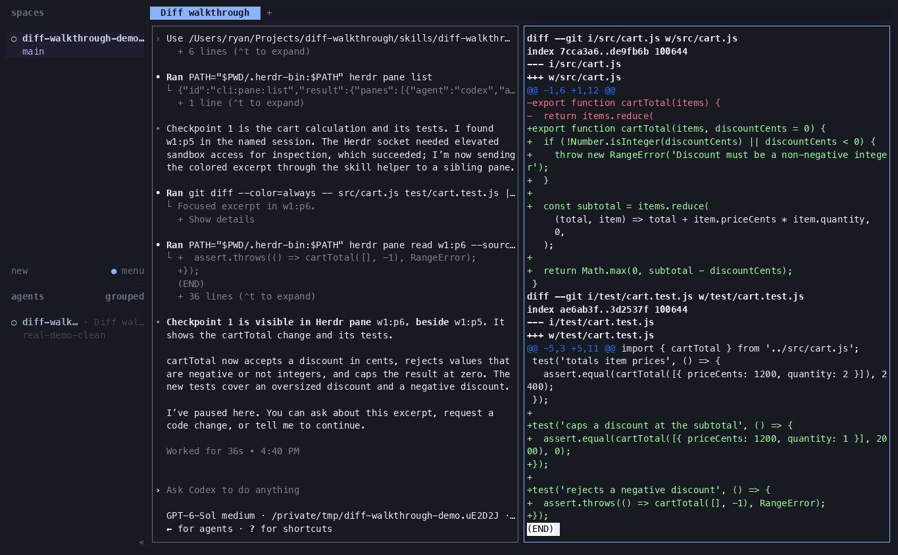

# Diff Walkthrough

Walk through a code diff one checkpoint at a time in Herdr. The agent shows the implementation and related tests in one review pane, explains them, and waits for your questions or a request to continue.



## Install

**Requirements**
- [Herdr](https://herdr.dev/docs/install/)
- git
- jq
- less
- [bat](https://github.com/sharkdp/bat)

Install the skill for your coding agent with one command:

```bash
npx skills add ryanshepps/diff-walkthrough --skill diff-walkthrough --global
```

## Running

Start your agent inside Herdr, then ask it to use `diff-walkthrough` to review an unstaged diff or pull request.
